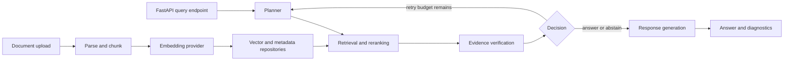

# SentinelRAG

**Evidence-aware retrieval with explicit decisions, bounded retries, and replaceable AI providers.**

SentinelRAG explores how a retrieval-augmented generation service can inspect its evidence before answering. A FastAPI backend coordinates retrieval, verification, and response generation through a LangGraph state machine. A React interface exposes query and ingestion workflows.

## Architecture



The dependency assembly lives in [`backend/app/api/dependencies.py`](backend/app/api/dependencies.py). Services depend on interfaces, allowing deterministic providers and in-memory repositories to support local development without paid APIs.

## Run locally

Start from the repository root. Python 3.12 is the container baseline.

```bash
cd backend
python3.12 -m venv .venv
source .venv/bin/activate
python -m pip install -r requirements.txt -r requirements-dev.txt
AI_PROVIDER=deterministic python -m uvicorn app.main:app --reload --host 127.0.0.1
```

Open <http://127.0.0.1:8000/docs> for the API explorer. `GET /health` checks application liveness.

In a second terminal:

```bash
cd frontend
npm ci
npm run dev
```

See [`frontend/.env.example`](frontend/.env.example) for frontend configuration. Real AI providers require separate credentials; deterministic mode is intended for repeatable development, not evaluation of model quality.

### Query the API

```bash
curl http://127.0.0.1:8000/api/v1/query \
  -H 'Authorization: Bearer local-demo' \
  -H 'Content-Type: application/json' \
  -d '{"query":"What is the refund policy?","top_k":20,"rerank_top_n":5}'
```

An empty in-memory corpus cannot answer questions about your documents. Upload a supported PDF, DOCX, TXT, or Markdown document through `/api/v1/documents/upload`, then poll `/api/v1/documents/{id}/status` before querying it.

## Verification

Run backend checks from `backend/`:

```bash
AI_PROVIDER=deterministic python -m pytest
```

`pytest.ini` excludes integration tests by default. Real-infrastructure tests require their backing services and an explicit `-m integration` selection. Run `npm run typecheck` and `npm run build` from `frontend/` to verify the interface. Test results should be reported for the exact commit and environment; historical reports are not a substitute for current checks.

## Deployment boundaries

This is an engineering prototype. Before exposing it to untrusted clients, address these current limitations:

- **Authentication:** the authorization dependency accepts a nonempty header; it does not validate identity or grant tenant isolation. The example token is a development placeholder.
- **Persistence:** the application factories currently return in-memory vector and metadata repositories. Process restarts lose this state. Starting PostgreSQL, Redis, and Qdrant in Compose does not automatically wire them into the application.
- **Verification:** the default NLI verifier and reranker are deterministic substitutes. Their diagnostics are not calibrated confidence scores or a factuality guarantee.
- **Operations:** CORS, upload/resource bounds, durable background processing, readiness checks, and provider failure handling need deployment-specific review.

The root Compose stack supplies development infrastructure and optional observability. It is not a production deployment contract. See [engineering priorities](docs/ENGINEERING_PRIORITIES.md).

## Design notes

- [Retrieval domain design](docs/RETRIEVAL_DOMAIN_DESIGN.md)
- [Ingestion pipeline](docs/INGESTION_PIPELINE_REPORT.md)
- [Provider migration](docs/PROVIDER_MIGRATION_REPORT.md)
- [Architecture enhancements](docs/ARCHITECTURE_ENHANCEMENTS.md)

These notes include historical implementation reports; use the current source and tests to establish actual behavior.
